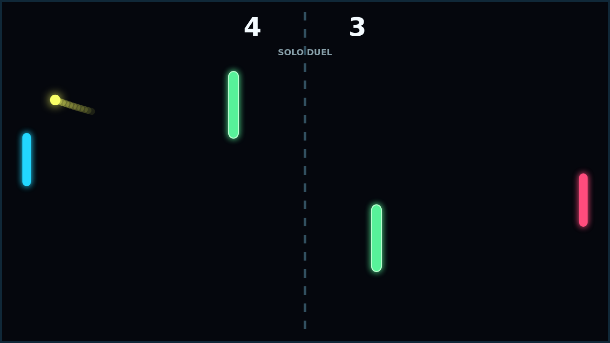

# Carom

Carom is a quick, clean paddle duel where every return can change shape after it
leaves the paddle. Move as you strike and the ball bends through the dark field,
turning a simple rally into a contest of timing, angles, and nerve.

The center obstacles make each point feel like a bank-shot puzzle. A careful
return can ricochet into trouble, while a well-placed curve can slip through the
middle and leave the far paddle chasing a late break.

Solo play pits you against a steady AI defender, and Versus turns the same field
into a local keyboard duel. Matches race to eleven and demand a two-point lead,
so long rallies at match point can still swing the whole game.
